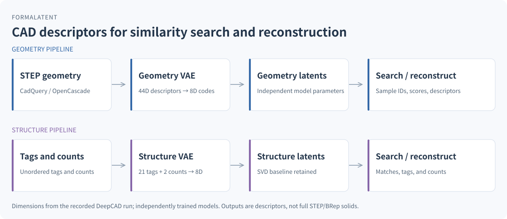

# FormaLatent

**Neural representations and similarity search for CAD geometry and structure.**

[简体中文](README.zh-CN.md) · [Getting started](docs/getting-started.en.md) · [Documentation](docs/README.md)

Train NumPy VAEs to encode CAD descriptors, reconstruct features, and retrieve similar samples. Runs independently of the AI-CAD workbench.



## Features

- Geometry and structure VAEs with learned matrices, Adam, and batch inference.
- STEP descriptors through CadQuery/OpenCascade; mixed latent/descriptor retrieval.
- Training, fine-tuning, encoding, decoding, and search through Python and CLI.

Decoding returns descriptors, not complete STEP solids. Raw datasets and pretrained weights are not distributed.

**Stack:** Python · NumPy · CadQuery/OpenCascade (optional STEP input). [Details](docs/tech-stack.en.md)

## Quick start

Python 3.10+. The synthetic example requires only NumPy:

```bash
git clone https://github.com/kkppshuai-svg/formalatent.git
cd formalatent
python -m pip install -r requirements.txt
python examples/create_demo_dataset.py
python scripts/train_brep_vae.py --dataset data/demo/geometry.jsonl --out models/demo.json --latent-dim 2 --hidden-dim 16 --epochs 100
python scripts/vae_cli.py search --model models/demo.json --input data/demo/query.json --limit 3
```

For environment setup, STEP inputs, and encoding/decoding, see [Getting started](docs/getting-started.en.md).

## Documentation

- [CLI and Python API (中文)](docs/reference.md)
- [Neural architecture and matrices](docs/neural-network.en.md)
- [Recorded DeepCAD evaluation (中文)](docs/deepcad-training.md) · [Validation scope (中文)](docs/validation.md)
- [Contributing (中文)](CONTRIBUTING.md) · [Issues](https://github.com/kkppshuai-svg/formalatent/issues)

Originates from [AI-CAD](https://github.com/kkppshuai-svg/ai-cad). No standalone license text is currently included; see the [project statements](docs/README.md#project-statements).
