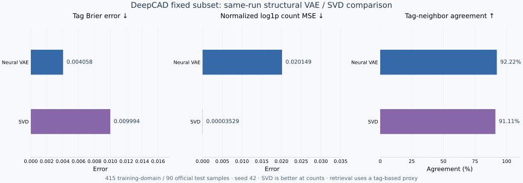

# FormaLatent

**Latent representations, descriptor reconstruction, and similarity search for CAD geometry and structure.**

[简体中文](README.zh-CN.md) · [Getting started](docs/getting-started.en.md) · [Tech stack](docs/tech-stack.en.md) · [Reference (中文)](docs/reference.md) · [Validation (中文)](docs/validation.md) · [Contributing (中文)](CONTRIBUTING.md)

FormaLatent uses trainable neural VAEs to encode geometric descriptors or structural tags into latent vectors. It provides NumPy-based training, batched inference, descriptor reconstruction, and sample retrieval, independently of the AI-CAD web service. STEP feature extraction uses CadQuery/OpenCascade.


The geometry and structure VAEs are trained separately. The recorded DeepCAD run used 44-dimensional geometric descriptors and an 8-dimensional latent space. Decoding returns statistical descriptors, not complete STEP/BRep solids.

## Capabilities

- Geometry descriptors covering topology counts, bounding-box ratios, mass properties, surface/curve types, and adjacency statistics.
- Mini-batch Adam training, KL warmup, validation early stopping, and full-weight fine-tuning.
- Cached batch encoding, posterior parameters, decoding, reconstruction, and mixed latent/descriptor retrieval.
- A separate structural VAE for tags and counts, with an SVD baseline.
- CLI, Python runtime, and AI-CAD integration entry points.

## Technology stack

| Layer | Technology | Responsibility |
| --- | --- | --- |
| Core runtime | Python 3.10+ | Training, CLI, and batch inference |
| Neural computation | NumPy ≥1.24,<3 | Dense weight matrices, nonlinear forward passes, explicit gradients, and Adam |
| STEP features | CadQuery ≥2.4,<3 / OpenCascade | Optional native geometry extraction |
| Model and data formats | JSON, JSONL, NumPy NPZ | Model parameters, sample records, and experiment arrays |
| Verification | pytest ≥7,<10 | Training, schema, runtime, CLI, and regression checks |
| AI-CAD integration | JavaScript ES modules / Node.js | Deterministic structural posterior-mean inference and integration checks |

Python and NumPy are the standalone core; CAD, testing, and workbench integration are separate layers. See [technology stack and module map](docs/tech-stack.en.md) for dependency files and source entry points.

## Neural architecture and matrices

The VAEs are fully connected neural networks with learned weight matrices, tanh activations, Gaussian posterior branches, reparameterized sampling, explicit backpropagation, and Adam updates. NumPy performs the matrix operations; SVD is a separate non-neural baseline.


For the recorded geometry configuration, a batch follows `X[N,44] → H1[N,64] → {mu[N,8], logvar[N,8]} → Z[N,8] → H2[N,64] → reconstructed descriptors[N,44]`.

| Recorded configuration | Encoder matrix | Posterior matrices | Decoder matrices | Trainable parameters |
| --- | --- | --- | --- | ---: |
| Geometry VAE | 44 × 64 | Two 64 × 8 matrices | 8 × 64, 64 × 44 | 7,356 |
| Structure VAE | 23 × 128 | Two 128 × 8 matrices | 8 × 128, 128 × 23 | 9,255 |

Counts include biases. See [neural networks and matrix operations](docs/neural-network.en.md) for forward equations, losses, preprocessing, and an actual saved-model matrix inspection command.

## Minimal example

Python 3.10+ and NumPy are sufficient for this synthetic example. No STEP files, GPU, AI credentials, or pretrained weights are required.

```bash
git clone https://github.com/kkppshuai-svg/formalatent.git
cd formalatent
python -m pip install -r requirements.txt
python examples/create_demo_dataset.py --out-dir data/demo
python scripts/train_brep_vae.py --dataset data/demo/geometry.jsonl --out models/demo.json --latent-dim 2 --hidden-dim 16 --epochs 100 --seed 42
python scripts/vae_cli.py encode --model models/demo.json --input data/demo/query.json --out data/demo/latents.json
python scripts/vae_cli.py decode --model models/demo.json --input data/demo/latents.json --out data/demo/reconstructed.json
python scripts/vae_cli.py search --model models/demo.json --input data/demo/query.json --limit 3
```

The walkthrough uses 32 synthetic 3D records and two queries. Encoding returns `(2, 2)` and decoding returns `(2, 3)`. These are workflow checks, not CAD accuracy or unseen-part retrieval measurements. See the [executed example summary](examples/demo-result.json).

Install `requirements-cad.txt` for STEP extraction. A STEP-query model must use the built-in 44-dimensional feature schema; the synthetic model is incompatible. Environment setup is in [Getting started](docs/getting-started.en.md); the full dataset workflow is in the [Chinese usage guide](docs/usage.md).

## Recorded evaluation

The 2026-09-23 DeepCAD run retained 505 samples: 415 training-domain records and 90 isolated official test records. Test data did not participate in normalization, vocabulary construction, early stopping, or checkpoint selection.

| Held-out metric | Neural VAE | Same-run reference |
| --- | ---: | ---: |
| Structural tag Brier error ↓ | 0.004058 | SVD: 0.009994 |
| Normalized log1p count MSE ↓ | 0.020149 | SVD: 0.00003529 |
| Tag Jaccard nearest-neighbor agreement ↑ | 92.22% | SVD: 91.11% |
| Normalized geometric reconstruction MSE ↓ | 0.057888 | Training-mean prediction: 0.726326 |

The neural model improved tag reconstruction and the retrieval proxy in this run; SVD remained substantially better at count reconstruction. Jaccard agreement is a tag-based proxy, not human-labeled semantic accuracy. Results are historical, fixed-subset measurements, not universal performance claims.



The repository includes [result summaries](benchmarks/deepcad-anysearch-505-results.json), [reload audit](benchmarks/deepcad-anysearch-505-audit.json), and [training records](docs/deepcad-training.md), but no raw training dataset or pretrained weights. This documentation update did not retrain the 505-sample experiment.

## Scope and development

Descriptor losses and retrieval scores do not replace BRep validity, dimensional, assembly, or manufacturing checks. The project has no latent-to-solid decoder or native NVIDIA USD BRep feature adapter. See [validation boundaries](docs/validation.md).

Install `requirements-dev.txt`, set `PYTHONPATH=scripts`, and run `python -m pytest scripts -q`. Report minimal reproducible issues through [GitHub Issues](https://github.com/kkppshuai-svg/formalatent/issues). Contribution priorities are in [CONTRIBUTING.md](CONTRIBUTING.md).

If this project is useful to your CAD representation or retrieval work, a Star helps you follow its development.

## Provenance and licensing

The geometric implementation originates from [AI-CAD](https://github.com/kkppshuai-svg/ai-cad), baseline commit `52f44be`. Implementation version 3.0.0 is distinct from model format identifiers and is not a claim of a published package or Git release.

No standalone license text is currently included. Third-party code and data retain their own authorization conditions. Generated models can contain sample identifiers, names, and descriptors.
