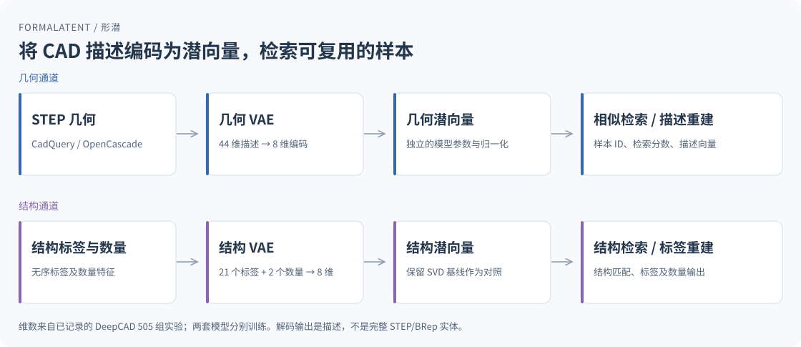

# FormaLatent · 形潜

**面向 CAD 几何与结构的神经表征、相似检索与关节补全。**

[English](README.md) · [快速开始](docs/getting-started.md) · [文档中心](docs/README.md)

使用 NumPy VAE 编码 CAD 描述、重建特征并检索相似样本。这条流程可独立运行。AI-CAD 关节补全流程使用 PyTorch 结构图 VAE 排序，由 CadQuery 重放并检查候选。



## 功能

- 几何与结构神经 VAE：可学习矩阵、Adam 和批量推理。
- CadQuery/OpenCascade 提取 STEP 描述，支持潜空间与描述混合检索。
- Python 和 CLI 提供训练、微调、编码、解码及查询。
- [AI-CAD 关节补全](docs/mechanism-feedback.md#补全一个关节端点)根据现有装配结构对候选子零件排序，验证前三名并输出通过检查的方案 JSON。离线命令一次处理一个转动或滑动关节。

几何 VAE 的解码输出为统计描述。仓库提供关节补全的训练脚本和可生成的机构示例。

**技术栈：** Python · NumPy · CadQuery/OpenCascade · PyTorch 与 Node.js（关节补全）。[详细说明](docs/tech-stack.md)

## 快速开始

Python 3.10+，合成示例只需 NumPy：

```bash
git clone https://github.com/kkppshuai-svg/formalatent.git
cd formalatent
python -m pip install -r requirements.txt
python examples/create_demo_dataset.py
python scripts/train_brep_vae.py --dataset data/demo/geometry.jsonl --out models/demo.json --latent-dim 2 --hidden-dim 16 --epochs 100
python scripts/vae_cli.py search --model models/demo.json --input data/demo/query.json --limit 3
```

环境配置、STEP 输入和编码/解码见[快速开始](docs/getting-started.md)。

## 文档

- [CLI 与 Python API](docs/reference.md)
- [神经网络与矩阵](docs/neural-network.md)
- [AI-CAD 结构图训练](docs/aicad-graph-training.md) · [关节补全操作与评估](docs/mechanism-feedback.md)
- [DeepCAD 实验记录](docs/deepcad-training.md) · [验证边界](docs/validation.md)
- [贡献规范](CONTRIBUTING.md) · [问题反馈](https://github.com/kkppshuai-svg/formalatent/issues)

源自 [AI-CAD](https://github.com/kkppshuai-svg/ai-cad)。仓库尚未附独立许可证文本，见[项目声明](docs/README.md#project-statements)。
