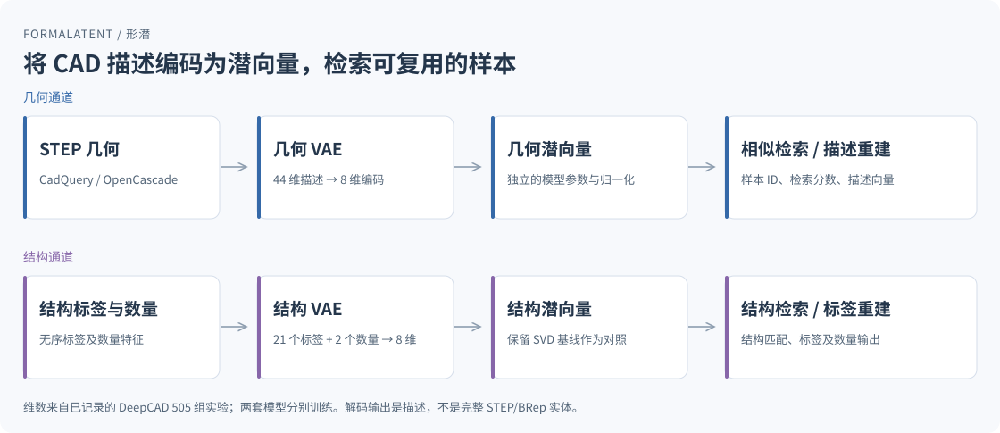
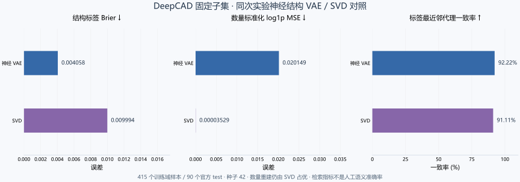

# FormaLatent · 形潜

**面向 CAD 几何与结构的潜空间学习、描述重建和相似检索。**

[English](README.md) · [快速开始](docs/getting-started.md) · [使用指南](docs/usage.md) · [接口参考](docs/reference.md) · [验证与边界](docs/validation.md) · [贡献规范](CONTRIBUTING.md)

FormaLatent 将 STEP 几何统计或结构标签编码为潜空间向量，用于组织 CAD 样本、查询相似零件及评估描述重建。核心使用 Python 与 NumPy，可独立于 AI-CAD Web 服务运行；STEP 特征提取依赖 CadQuery/OpenCascade。



*图示对应两套分别训练的模型。44 维几何输入和 8 维潜空间来自已记录的 DeepCAD 实验；潜空间维数可配置。解码得到描述向量，不是完整 STEP/BRep 实体。*

## 使用场景

| 场景 | 项目提供的能力 |
| --- | --- |
| 整理零件样本库 | 从 STEP 提取拓扑、比例、质量属性、曲面/曲线类型与邻接统计 |
| 查询相似样本 | 结合潜空间距离和几何描述距离，返回带分数的匹配列表 |
| 研究 CAD 表征 | 训练几何 VAE 或结构 VAE，查询后验参数、编码、解码和重建 |
| 适配新的样本域 | 使用完整预训练权重与原有归一化统计微调模型 |
| 接入建模工作台 | 提供批量运行时、CLI 和 AI-CAD 集成入口 |

几何 VAE 支持小批量 Adam、KL 权重预热、验证集早停和权重缓存。结构 VAE 学习标签与数量，保留 SVD 基线用于对照；它不等同于自然语言理解或 CAD 构造序列生成。

## 快速开始

需要 Python 3.10+。以下示例只安装 NumPy，不需要 STEP 文件、GPU、AI 账号或预训练权重。

```bash
git clone https://github.com/kkppshuai-svg/formalatent.git
cd formalatent
python -m pip install -r requirements.txt
python examples/create_demo_dataset.py --out-dir data/demo
python scripts/train_brep_vae.py --dataset data/demo/geometry.jsonl --out models/demo.json --latent-dim 2 --hidden-dim 16 --epochs 100 --seed 42
python scripts/vae_cli.py encode --model models/demo.json --input data/demo/query.json --out data/demo/latents.json
python scripts/vae_cli.py decode --model models/demo.json --input data/demo/latents.json --out data/demo/reconstructed.json
python scripts/vae_cli.py search --model models/demo.json --input data/demo/query.json --limit 3
```

示例创建 32 条三维合成记录，将两个查询编码成 `(2, 2)` 的潜向量，再解码成 `(2, 3)` 的描述数组。它用于验证调用流程，不衡量 CAD 重建质量或未见零件检索效果。已执行结果见[演示记录](examples/demo-result.json)。

独立环境、Windows PowerShell 和 STEP 数据准备见[快速开始](docs/getting-started.md)及[使用指南](docs/usage.md)。

## 从 STEP 查询相似零件

处理真实 STEP 文件前，安装 `requirements-cad.txt`，并准备使用内置 44 维特征名称及顺序训练的模型：

```bash
python -m pip install -r requirements-cad.txt
python scripts/extract_brep_geometry.py --step path/to/part.step
python scripts/query_brep_vae.py --model models/geometry-vae.json --step path/to/query.step --limit 5
```

三维合成示例模型不能用于该 STEP 查询。几何 JSONL 的批量准备、训练和微调流程见[使用指南](docs/usage.md)；批量编码、后验与混合检索接口见[接口参考](docs/reference.md)。

## 已记录的实验结果

2026-09-23 的 DeepCAD 实验保留 505 组有效样本：415 组训练域、90 组官方 test。测试样本不参与训练、归一化、词表构建、早停或权重选择。结构与几何模型分别训练，实验潜空间维数均为 8。

| 独立测试指标 | 神经 VAE | 同次实验对照 |
| --- | ---: | ---: |
| 结构标签 Brier 误差 ↓ | 0.004058 | 同输入 SVD：0.009994 |
| 数量标准化 log1p MSE ↓ | 0.020149 | 同输入 SVD：0.00003529 |
| 标签 Jaccard 最邻近一致率 ↑ | 92.22% | 同输入 SVD：91.11% |
| 几何标准化重建 MSE ↓ | 0.057888 | 训练均值预测：0.726326 |



结构 VAE 在标签重建和检索代理上优于该次 SVD 对照，数量重建仍明显落后。Jaccard 一致率是结构标签代理，不是人工标注的语义检索准确率。仓库保存了[原始汇总指标](benchmarks/deepcad-anysearch-505-results.json)、[重载审计](benchmarks/deepcad-anysearch-505-audit.json)和[训练记录](docs/deepcad-training.md)，但不分发原始数据或模型权重。

这些是固定样本和配置下的历史结果；不同数据域、归档或依赖版本可能产生不同结果。小规模多种子实验和性能测量的限制见[评估报告](docs/evaluation.md)。

## 实现与验证范围

| 项目 | 当前状态 |
| --- | --- |
| 几何实现标识 | 3.0.0；不代表已发布同名软件包或 Git 标签 |
| 几何模型格式 | `ai-cad-brep-vae-v2` |
| 结构模型格式 | `formalatent-structure-vae-v1` |
| 内置 STEP 描述 | 44 维；训练和查询必须使用一致的 schema |
| 核心运行环境 | Python 3.10+、NumPy；CadQuery 为可选几何依赖 |

解码输出不包含重建完整实体所需的拓扑与参数信息。潜空间距离、重建误差和检索分数不替代 BRep 有效性、尺寸、装配或制造检查。适用范围、数据泄漏控制和复现条件见[验证与边界](docs/validation.md)。

## 项目文档

| 文档 | 内容 |
| --- | --- |
| [快速开始](docs/getting-started.md) | Linux/Windows 环境与可运行合成示例 |
| [使用指南](docs/usage.md) | STEP 数据准备、训练、微调、查询与常见问题 |
| [接口参考](docs/reference.md) | CLI、Python API、数据格式和兼容性 |
| [验证与边界](docs/validation.md) | 指标定义、验证覆盖和未实现范围 |
| [结构神经 VAE](docs/structure-vae.md) | 标签与数量建模、SVD 对照和 AI-CAD 接入 |
| [DeepCAD 训练记录](docs/deepcad-training.md) | 数据来源、样本筛选、独立测试及产物审计 |
| [评估报告](docs/evaluation.md) | 多种子实验、原始结果及复现条件 |
| [变更记录](CHANGELOG.md) | 实现行为与训练记录变更 |

## 开发与参与

```bash
python -m pip install -r requirements-dev.txt
```

Linux/Bash：`PYTHONPATH=scripts python -m pytest scripts -q`。PowerShell：先执行 `$env:PYTHONPATH = "scripts"`，再执行 `python -m pytest scripts -q`。

问题请提交到 [GitHub Issues](https://github.com/kkppshuai-svg/formalatent/issues)，附最小输入、运行环境和预期结果。贡献要求及可参与方向见[贡献规范](CONTRIBUTING.md)。如果项目对你的 CAD 表征或检索研究有帮助，欢迎 Star，便于关注后续进展。

## 来源与项目声明

FormaLatent 源自 [AI-CAD](https://github.com/kkppshuai-svg/ai-cad)，几何实现基线为 `52f44be`。它承担学习与检索，不承担建模内核或审查门禁职责。

仓库不分发原始训练数据或预训练权重。生成模型可能包含样本 ID、名称及描述向量。本仓库尚未提供独立许可证文本；第三方代码与数据的使用及再分发应遵循各自的授权条件。
