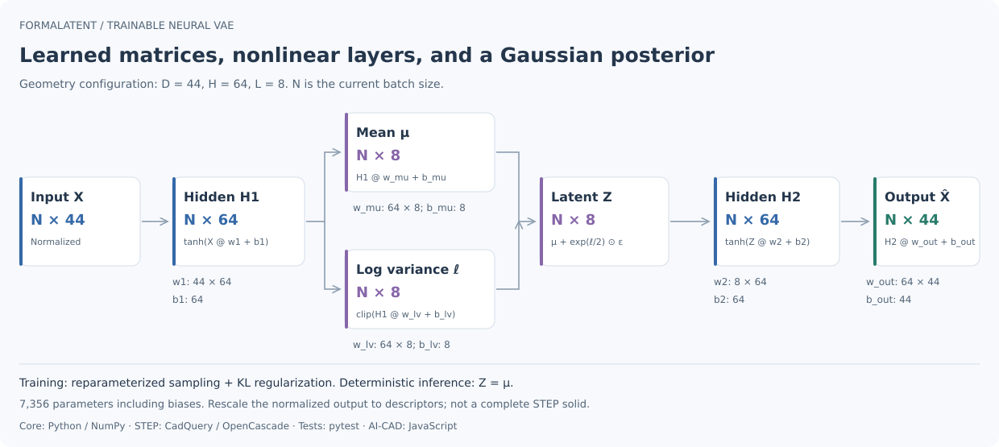

# Neural networks and matrix operations

[Overview](../README.md) · [中文](neural-network.md) · [Reference (中文)](reference.md)

Both the geometry and structure VAEs are trainable fully connected neural networks implemented in NumPy. They use matrix multiplication, nonlinear activations, explicit backpropagation, Adam, Gaussian posterior branches, reparameterized sampling, and KL regularization. The retained SVD baseline is separate and non-neural.



The figure uses the recorded geometry configuration `D=44, H=64, L=8`. `N` is the current batch size. The structure VAE shares the parameter layout, with different dimensions, preprocessing, and reconstruction objectives.

## Parameter arrays

Each model has five weight matrices and five bias vectors. The following dimensions come from the recorded 505-sample DeepCAD run, rather than a requirement for every model.

| Parameter | Purpose | Geometry: D=44,H=64,L=8 | Structure: D=23,H=128,L=8 |
| --- | --- | --- | --- |
| `w1` | Input to encoder hidden layer | 44 × 64 | 23 × 128 |
| `w_mu` | Hidden layer to posterior mean | 64 × 8 | 128 × 8 |
| `w_lv` | Hidden layer to posterior log variance | 64 × 8 | 128 × 8 |
| `w2` | Latent vector to decoder hidden layer | 8 × 64 | 8 × 128 |
| `w_out` | Hidden layer to descriptor output | 64 × 44 | 128 × 23 |
| Biases | `b1,b_mu,b_lv,b2,b_out` | 64,8,8,64,44 | 128,8,8,128,23 |
| Trainable parameters | All weights and biases | **7,356** | **9,255** |

The count is `2DH + 3HL + 2H + 2L + D`, excluding normalization statistics and sample metadata. The 23-dimensional structure input in this run contains 21 tags and two counts. Vocabulary changes also change input and weight dimensions.

## Geometry forward pass

`X` is an `N × D` matrix normalized by training-domain feature statistics. Biases broadcast across batch rows.

```text
H1 = tanh(X @ w1 + b1)                           [N, H]
mu = H1 @ w_mu + b_mu                            [N, L]
logvar = clip(H1 @ w_lv + b_lv, -8, 5)            [N, L]
epsilon ~ Normal(0, I)                            [N, L]
Z = mu + exp(0.5 * logvar) * epsilon              [N, L]
H2 = tanh(Z @ w2 + b2)                           [N, H]
X_hat_normalized = H2 @ w_out + b_out             [N, D]
X_hat = X_hat_normalized * feature_std + feature_mean
```

`@` is matrix multiplication; `*` is elementwise multiplication. Training samples `epsilon`. Deterministic encoding and reconstruction use `Z = mu`.

The geometry objective uses element-mean reconstruction MSE and KL regularization, matching the implementation's averaging conventions:

$$
\mathcal{L}_{rec}=\frac{1}{ND}\sum_{i,j}(\hat X_{ij}-X_{ij})^2
$$

$$
\mathcal{L}_{KL}=-\frac{1}{2NL}\sum_{i,j}\left(1+\ell_{ij}-\mu_{ij}^2-e^{\ell_{ij}}\right),\qquad
\mathcal{L}=\mathcal{L}_{rec}+\beta\mathcal{L}_{KL}
$$

Here `ell = logvar`; `X_hat` in the loss denotes normalized output. KL weight follows the configured warmup. Explicit chain-rule gradients and Adam update the matrices and biases. See [init_params / forward / loss_and_gradients](../scripts/train_brep_vae.py).

## Structure-network differences

The structure input uses multi-hot tags and two log1p-transformed, training-normalized counts. Sigmoid converts tag logits to probabilities; count outputs are denormalized, clipped, and transformed with `expm1` to nonnegative predictions.

The objective combines mean binary cross-entropy for tags, mean MSE for counts, and weighted KL. Tags are not mutually exclusive softmax classes. Counts need not be integers and do not enforce assembly constraints. See [structure_vae.py](../scripts/structure_vae.py).

## Inspect a saved model

After running [Getting started](getting-started.en.md):

```bash
python examples/inspect_model_matrices.py --model models/demo.json
```

The output lists actual array shapes, parameter counts, and numeric excerpts of at most two rows and four columns. The synthetic `D=3,H=16,L=2` model has 231 trainable parameters; see the [executed matrix excerpt](../examples/neural-matrices-demo.json). These are synthetic-model weights, not unpublished DeepCAD pretrained weights.

The model JSON stores these arrays in `weights`. The geometry runtime validates shapes and finite values, caches NumPy arrays, and performs batched matrix operations.

## Scope

Neural descriptor encoding does not preserve complete CAD topology or construction history. Decoder outputs are descriptors or tag/count predictions, not complete STEP solids. See [validation boundaries (中文)](validation.md).
