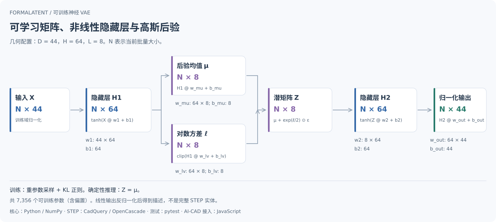

# 神经网络与矩阵计算

[中文首页](../README.zh-CN.md) · [English](neural-network.en.md) · [接口参考](reference.md)

FormaLatent 的几何 VAE 和结构 VAE 都是可训练的全连接神经网络。实现采用 NumPy 矩阵乘法、非线性激活、显式反向传播与 Adam 更新，包含高斯后验均值/对数方差分支、重参数采样及 KL 正则项。SVD 是独立保留的非神经基线。



图示采用已记录的几何配置 `D=44, H=64, L=8`。`N` 是当前批量大小，不是固定样本数。结构 VAE 使用相同参数布局，但输入维数、隐藏层宽度、预处理和重建目标不同。

## 参数矩阵

每个模型包含五个权重矩阵和五个偏置向量。以下维数来自 505 组 DeepCAD 实验配置；实际运行可配置其他维数。

| 参数 | 作用 | 几何 VAE：D=44,H=64,L=8 | 结构 VAE：D=23,H=128,L=8 |
| --- | --- | --- | --- |
| `w1` | 输入到编码隐藏层 | 44 × 64 | 23 × 128 |
| `w_mu` | 隐藏层到后验均值 | 64 × 8 | 128 × 8 |
| `w_lv` | 隐藏层到后验对数方差 | 64 × 8 | 128 × 8 |
| `w2` | 潜向量到解码隐藏层 | 8 × 64 | 8 × 128 |
| `w_out` | 解码隐藏层到描述输出 | 64 × 44 | 128 × 23 |
| 偏置 | `b1,b_mu,b_lv,b2,b_out` | 64,8,8,64,44 | 128,8,8,128,23 |
| 可训练参数总数 | 权重与偏置元素总数 | **7,356** | **9,255** |

参数总数为 `2DH + 3HL + 2H + 2L + D`，不计归一化统计、样本索引和训练元数据。结构输入的 23 维是该次实验的 21 个标签加两个数量特征；词表变化时，输入维数和权重形状也会变化。

## 几何前向计算

以下 `X` 已按训练域的逐特征均值和标准差归一化，形状为 `N × D`。偏置按批量行广播：

```text
H1 = tanh(X @ w1 + b1)                           [N, H]
mu = H1 @ w_mu + b_mu                            [N, L]
logvar = clip(H1 @ w_lv + b_lv, -8, 5)            [N, L]
epsilon ~ Normal(0, I)                            [N, L]
Z = mu + exp(0.5 * logvar) * epsilon              [N, L]
H2 = tanh(Z @ w2 + b2)                           [N, H]
X_hat_normalized = H2 @ w_out + b_out             [N, D]
X_hat = X_hat_normalized * feature_std + feature_mean
```

`@` 表示矩阵乘法，`*` 表示逐元素乘法。训练时采样 `epsilon`；确定性编码和重建使用 `Z = mu`。方差分支不是单一固定投影，而是随输入变化的可训练后验参数。

几何训练目标为归一化重建 MSE 加上加权 KL 项。下面损失公式的 `X_hat` 指归一化输出；与源码一致，两个指标分别按 `N × D` 和 `N × L` 的元素数取平均：

$$
\mathcal{L}_{rec}=\frac{1}{ND}\sum_{i,j}(\hat X_{ij}-X_{ij})^2
$$

$$
\mathcal{L}_{KL}=-\frac{1}{2NL}\sum_{i,j}\left(1+\ell_{ij}-\mu_{ij}^2-e^{\ell_{ij}}\right),\qquad
\mathcal{L}=\mathcal{L}_{rec}+\beta\mathcal{L}_{KL}
$$

其中 `ell = logvar`。KL 权重按配置预热；梯度通过显式链式计算得到，Adam 更新这些矩阵与偏置。源码见 [init_params / forward / loss_and_gradients](../scripts/train_brep_vae.py)。

## 结构网络的区别

结构网络复用参数布局和前向计算，但输入是多热标签加两个经过 `log1p` 和训练域归一化的数量特征。标签输出通过 sigmoid 得到概率，数量输出反归一化后通过裁剪与 `expm1` 得到非负预测。

训练目标是标签平均二元交叉熵、数量平均 MSE 和加权 KL 项。标签不是 softmax 互斥类别；多个标签可以同时出现。数量预测不强制取整，也不能保证满足装配约束。实现见 [structure_vae.py](../scripts/structure_vae.py)。

## 查看实际模型的矩阵

先按[快速开始](getting-started.md)训练合成示例，再执行：

```bash
python examples/inspect_model_matrices.py --model models/demo.json
```

输出包含每个参数的真实形状、元素数量以及最多两行四列的数值节选。合成示例 `D=3,H=16,L=2` 共 231 个可训练参数；实际执行结果见[矩阵节选](../examples/neural-matrices-demo.json)。这些值来自合成模型，不是未公开的 DeepCAD 预训练权重。

模型 JSON 的 `weights` 保存这些参数数组；几何运行时会验证形状及有限值并缓存为 NumPy 数组，批量推理通过矩阵乘法执行。

## 输出边界

矩阵化神经网络表征的是输入描述，不包含完整 CAD 拓扑或建模历史。解码得到统计描述或标签/数量预测，不等于生成 STEP 实体。完整实验边界见[验证与边界](validation.md)。
